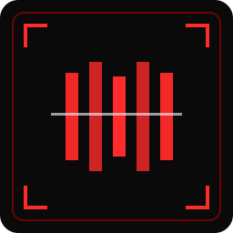
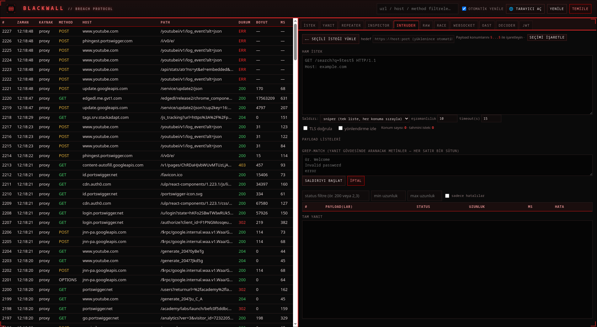

<div align="center">
  

  # Blackwall

  **A mitmproxy-powered web pentesting tool — built from scratch to solve PortSwigger Web Security Academy labs.**

  Its own engine and UI. Not Burp, not a Burp plugin.
</div>

---

Blackwall captures HTTP(S) and WebSocket traffic through an embedded [mitmproxy](https://mitmproxy.org/) engine, stores it in SQLite, and exposes a single-page web UI (FastAPI backend) with the tools you need to work a lab end to end: inspect history, replay and tamper requests, brute-force with payload sets, decode/forge tokens, catch out-of-band interactions, and run byte-level request-smuggling and race-condition attacks.

It runs either as a **desktop app** (its own window via PyWebView) or **headless** in your browser.

> ⚠️ Blackwall sends raw, sometimes malformed bytes on purpose (request smuggling, HTTP/2 frame injection, race salvos). Use it **only** against systems you own or are explicitly authorized to test. See [Legal](#legal--responsible-use).

<p align="center">
  
</p>

## Features

- **Intercepting proxy + HTTP history** — all HTTP(S) flows captured to SQLite, searchable/filterable history table.
- **Repeater** — edit and resend any request; **tabbed**, each tab keeps its own request/response.
- **Intruder** — `§marker§` based attacks with **sniper / pitchfork / cluster bomb**, payload lists and generators (number ranges, charsets), concurrency, sortable/filterable results, and **grep-match** (flag responses containing given strings).
- **Decoder / JWT / Inspector** — multi-layer encode/decode (base64, URL, HTML, hex, ASCII) + MD5/SHA hashing; JWT decode, `alg:none` forge, and local HS256 signing; request Inspector (query params, cookies, headers). All offline.
- **OAST (self-hosted-capable)** — pure-Python [interactsh](https://github.com/projectdiscovery/interactsh) client (no external binary): registers with an RSA key, polls for DNS/HTTP interactions, decrypts them locally. Point it at the public server or your own interactsh instance.
- **WebSocket capture + injection** — records messages per connection and injects your own messages into a live connection (direction-selectable).
- **Raw sender** — pure TCP/TLS socket, your bytes untouched (no auto Content-Length/Transfer-Encoding, header order preserved). Supports **HTTP/1.1 and HTTP/2** (including malformed-frame and CRLF-in-header-value for **request smuggling**), request pipelining, and smuggle + follow-up over one connection.
- **Race** — timing attacks via **last-byte synchronization (HTTP/1.1)** and **single-packet attack (HTTP/2)**; fires N requests in one salvo and highlights race-winner responses.
- **One-click browser** — launches your installed Chromium/Chrome pre-configured with the proxy and a throwaway profile; the mitmproxy CA is loaded into that profile's isolated store so HTTPS "just works" (falls back to ignoring cert errors if `certutil`/CA is unavailable). Your normal browser profile is never touched.
- **Desktop app** — runs in its own window (PyWebView); proxy + web server + window start together and shut down cleanly on close. Cyberpunk-themed UI.

## Requirements

- **Linux** (developed/tested there; the desktop window needs a display — X11 or Wayland). Headless mode works anywhere Python + mitmproxy run.
- **Python 3.11+**
- Optional: `certutil` (NSS tools) for the one-click browser's isolated CA trust, and a Chromium-based browser (`chromium`, `google-chrome`, `brave`, …) for that feature.

## Installation

Clone the repo, create a virtual environment, and install the dependencies — nothing is hard-coded to a specific machine or path:

```bash
git clone https://github.com/<your-username>/blackwall.git
cd blackwall

python3 -m venv .venv
.venv/bin/pip install -r requirements.txt
```

That's it. The SQLite database is created automatically on first run, next to the project (override with `BLACKWALL_DB`).

## Running

### Desktop app (recommended)

Starts the proxy, the web server, and the application window together. Closing the window shuts everything down cleanly.

```bash
.venv/bin/python app.py
```

### Headless (in your browser)

For servers without a display, or if you prefer a browser tab:

```bash
./run.sh
```

Then open the web UI yourself.

### Endpoints & configuration

Both modes expose the same services:

| What | Default | Notes |
|------|---------|-------|
| Proxy | `http://127.0.0.1:8080` | Point your browser/device proxy here (or use the one-click browser) |
| Web UI | `http://127.0.0.1:8000` | Opened automatically in the desktop app |
| Database | `./blackwall.db` | SQLite (WAL mode) |

Override ports and DB path via environment variables (work with both `app.py` and `run.sh`):

```bash
PROXY_PORT=9090 WEB_PORT=9000 BLACKWALL_DB=/tmp/run1.db .venv/bin/python app.py
```

### HTTPS capture (certificate)

To decrypt HTTPS, the client must trust the mitmproxy CA.

- **Easiest:** click **🌐 Open Browser** in the top bar — it launches a throwaway Chromium with the CA pre-loaded into an isolated store. No manual setup.
- **Your own browser:** the CA is generated under `~/.mitmproxy/` the first time the proxy runs (or visit `http://mitm.it` while the proxy is active). Import `~/.mitmproxy/mitmproxy-ca-cert.pem` into your browser/OS trust store and set its proxy to `127.0.0.1:8080`.

## MCP server (Claude Desktop & other MCP clients)

Blackwall ships an optional [MCP](https://modelcontextprotocol.io/) server
([`mcp_server.py`](mcp_server.py)) so assistants like **Claude Desktop** can drive
its tools (`get_history`, `get_flow`, `send_request`, `run_intruder`, `decode`,
`jwt_decode`, `jwt_sign`, `check_oast`) as tool calls. It talks to a running
Blackwall over HTTP and gates outbound tools behind a `BLACKWALL_ALLOWED_HOSTS`
allow-list. Setup and the Claude Desktop config are in **[MCP_README.md](MCP_README.md)**.

## Dependencies

All installed from `requirements.txt`. Blackwall itself is MIT-licensed; the libraries it builds on keep their own licenses:

| Library | Role | License |
|---------|------|---------|
| [mitmproxy](https://github.com/mitmproxy/mitmproxy) | Intercepting proxy engine (addon) | MIT |
| [FastAPI](https://github.com/tiangolo/fastapi) | Web/API backend | MIT |
| [uvicorn](https://github.com/encode/uvicorn) | ASGI server | BSD-3-Clause |
| [httpx](https://github.com/encode/httpx) | HTTP client (Repeater/Intruder send path) | BSD-3-Clause |
| [h2](https://github.com/python-hyper/h2) | HTTP/2 framing (Raw & Race) | MIT |
| [cryptography](https://github.com/pyca/cryptography) | RSA/AES for the OAST client | Apache-2.0 / BSD |
| [pywebview](https://github.com/r0x0r/pywebview) | Desktop window (Qt/QtWebEngine backend) | BSD-3-Clause |

The interactsh protocol is implemented from scratch in pure Python; no ProjectDiscovery binary is bundled.

## Legal & responsible use

**Blackwall is for authorized security testing and education only.**

Use it **only** against systems you own or for which you have explicit, written permission to test — for example [PortSwigger Web Security Academy](https://portswigger.net/web-security) labs, your own lab environments, or engagements with a signed scope. Sending the kind of traffic this tool generates (request smuggling, malformed HTTP/2, race salvos, payload brute-forcing) to systems you are not authorized to test may be **illegal** and is your responsibility alone.

The author provides this software "as is", without warranty, and accepts no liability for misuse or any damage resulting from its use. By using Blackwall you agree you are solely responsible for complying with all applicable laws.

## License

[MIT](LICENSE) © 2026 Kaan Ulusoy
